

  

<h1 align="center">aapdaAlert</h1>

  <b>Other apps tell you a disaster is coming. aapdaAlert gets you rescued once it's here, in your own language, even when the network fails.</b>

  Live demo: <a href="https://apada-alert.vercel.app">apada-alert.vercel.app</a> · Control room: <a href="https://apada-alert.vercel.app/dashboard">/dashboard</a> · Crew: <a href="https://apada-alert.vercel.app/crew">/crew</a>
   
  Built for <b>PromptWars x Code1 Innovators</b> (Hack2skill), problem statement <b>PS05: Northeast Connect, Community Emergency Assistant</b>

  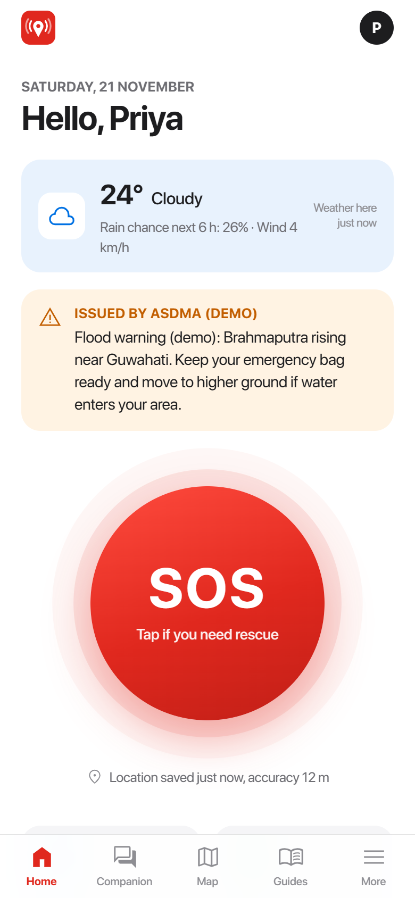
  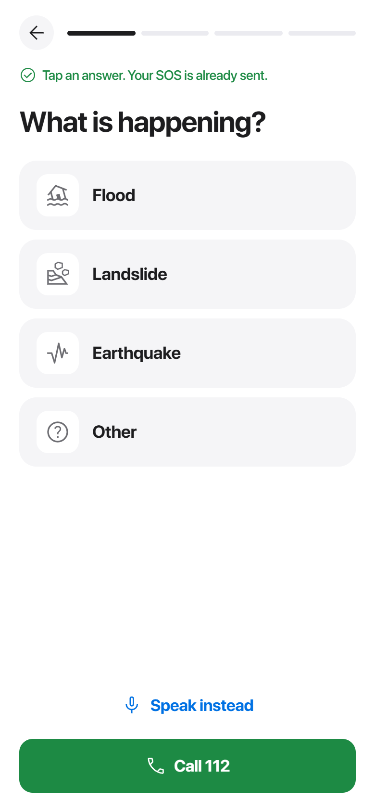
  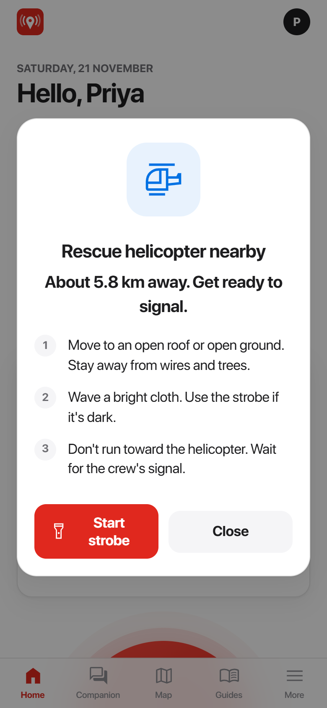

---

## What it is

**aapdaAlert** ("aapda" means disaster) is an installable web app for people in North East India facing floods, landslides, earthquakes and storms, and a control room for the teams who rescue them.

It does three jobs:

1. **Helps the person in danger.** One tap sends an SOS with their location and household details. An AI companion talks to them in Assamese, Bengali, Hindi or English. When they are in danger it stops chatting and asks a few tap-only questions, read aloud, so no one has to type in a panic.
2. **Helps rescuers decide who to reach first.** Every SOS arrives on a live map, ranked by urgency, with a one-line explanation written by AI.
3. **Brings the two together on the ground.** When a rescue helicopter or boat comes close, the stranded person's phone tells them to get ready, then flashes and sounds a siren so the crew can find them.

## The problem

- Floods hit Assam and its neighbouring states every year. The hill states face landslides, and the whole region is in a high earthquake zone.
- During a disaster the mobile network is weak or keeps dropping. A help request sent at the wrong moment is simply lost.
- Safety information is mostly in English. Many affected people are more at home in Assamese, Bengali or Hindi, and many phones have no Assamese voice at all.
- Rescue teams often don't know exactly where stranded people are, how many there are, or who needs help first.
- People hear a helicopter only once it has passed. They miss the moment to signal it.

## What makes it different

| Most disaster apps today | aapdaAlert |
|---|---|
| Send alerts one way, to the public | Two-way: the person sends an SOS, the control room answers, the crew finds them |
| Need you to type or fill forms | **Send first, ask after:** the SOS leaves on the first tap; a few tap-only questions add detail |
| Lose your request if the network drops | **Never loses an SOS:** it waits on the phone and sends itself when the network is back |
| English or Hindi | **Assamese, Bengali, Hindi and English**, including a natural **AI voice** in each |
| No way to know rescuers are close | **Rescue helicopter alert** at 10 km and 3 km, with SOS strobe and siren |
| A list of requests for rescuers | **Ranked by urgency** (badly hurt, stuck, water level, elderly or children) with an **AI reason** |
| Citizens on their own | **People nearby** can ask each other for water, boats or help, and the control room sees it |

## Who it's for

| Who | What they get |
|---|---|
| **People in flood, landslide and earthquake areas** of Assam, Meghalaya, Tripura, Mizoram, Manipur, Nagaland, Arunachal Pradesh and Sikkim | A one-tap SOS, an AI companion in their language, safety guides, first aid, the weather and official alerts. Works on low-end Android phones and weak networks. |
| **Elderly people, children and people with disabilities** (through their families) | Saved household details travel with every SOS, so rescuers reach them first |
| **Families and neighbours** | A nearby chat to say "I'm safe" or offer a boat, and SMS to emergency contacts |
| **Control rooms** (standing in for NDRF, SDRF and district emergency centres) | A live SOS map, urgency ranking, AI summaries, chat history, alerts and the community chat |
| **Rescue crews** in helicopters and boats | Share their position from a phone and see the nearest SOS with distance and direction |

## Features

### 1. SOS: send first, ask after

Tapping **SOS** sends the location and household details straight away. Then the app asks at most six questions, one at a time, with big buttons and the question read aloud:

- Are you in danger right now?
- What is happening?
- Is anyone hurt?
- Can you move to a safer place?
- How high is the water? (floods only)
- Are all your people with you?

Each answer updates the same SOS, and a back button lets you change an answer. At the end, **Do this now** shows steps for that exact situation, with buttons to call 112, copy an SMS, start the strobe, or open first aid.

  
  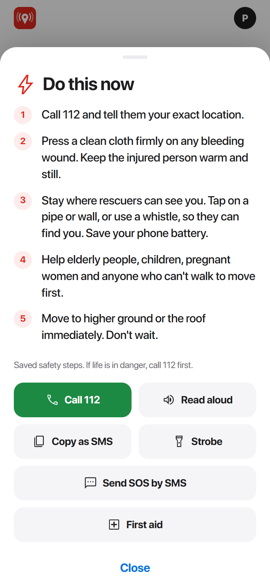

### 2. AI companion that knows when to stop talking

A calm chat companion powered by **Google Gemini**, by voice or text, in four languages. It knows the person's real situation: alerts near them, the weather, the nearest relief camp, their SOS status and any rescue unit close by.

The moment it hears danger ("water is coming into the house", "my father is hurt"), it stops chatting and switches to the tap-only questions. A safety check runs on the phone as well, so this works instantly even without the AI. When the person has already said something, Gemini picks the next question and skips anything it already knows.

  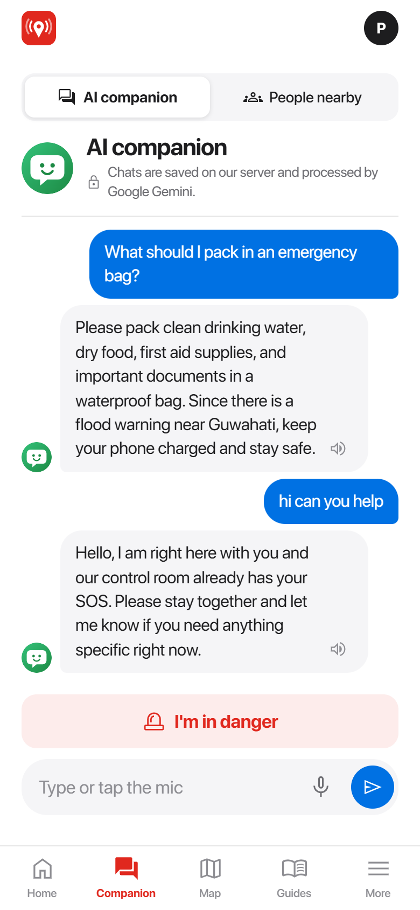

### 3. A natural voice in the person's own language

The danger questions and the helicopter alert are read aloud by a **Gemini AI voice** in Assamese, Bengali, Hindi or English. Most phones have no built-in Assamese voice, so this matters. Each phrase is made once, saved, and kept on the phone, so it plays instantly, even with no network.

### 4. Never loses an SOS

Every SOS, answer, report and chat message goes into an **outbox on the phone** first, then sends itself as soon as any network appears, with no duplicates. The app itself, the guides and the danger questions open with no network at all.

### 5. Rescue helicopter nearby

When a rescue unit comes within **10 km**, the phone says "get ready to signal". Within **3 km** it vibrates, sounds a **siren** and flashes **SOS in Morse code** across the whole screen, with short instructions: move to open ground, wave a bright cloth, don't run toward the helicopter. The crew page shows the crew who is nearest and how urgent they are.

  

### 6. People nearby

A simple chat with everyone within 30 km, similar in spirit to bitchat. One tap sends "I'm safe", "Need help", "Water and food", "Have a boat" or "Road flooded". "Need help" also offers the SOS questions, so asking neighbours can become a rescue request. Locations are rounded to about 1 km, messages last 24 hours, and a message is hidden once three different people report it. The control room sees the chat too, to catch needs that never became an SOS.

  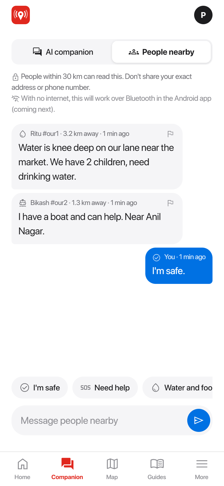

### 7. Official alerts and the weather where you are

Home shows live government alerts for North East India from **SACHET**, the National Disaster Management Authority's alert feed (IMD, CWC and state disaster authorities), each with who issued it and when. Alerts sent from the control room carry an "Issued by" label such as NDRF or ASDMA, and are translated by AI into all four languages. Above them sits the **weather where you are**: temperature, chance of rain in the next six hours, and a heavy-rain warning.

  
  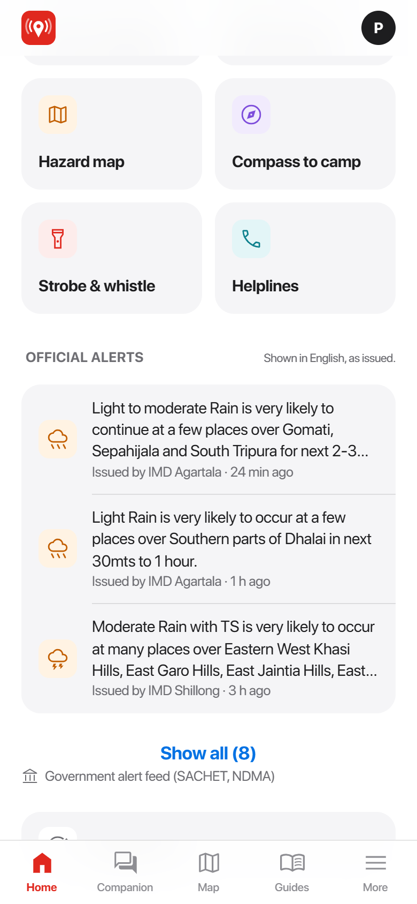

### 8. Hazard map

A map of flooded roads, landslides, blocked roads, damaged bridges and open relief camps reported by the community. Reports close to each other merge into "Confirmed by N reports", and **Gemini checks report photos** to filter out fakes. A list of nearby reports sits under the map.

  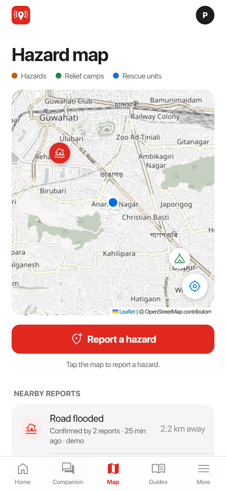

### 9. Safety guides and first aid

Fifteen guides in four languages, each read aloud:

- **Disasters:** flood, landslide, earthquake and lightning, each split into before, during and after.
- **If someone is hurt:**
  - where to go, with buttons for Call 108 ambulance, Hospitals near me, and Camps with medical care
  - heavy bleeding, not breathing, broken bones, burns, snake bite and electric shock
- **Staying healthy:** safe drinking water, and illness after floods.
- **Be prepared:** an emergency bag checklist, and helping elderly, children and disabled people.

  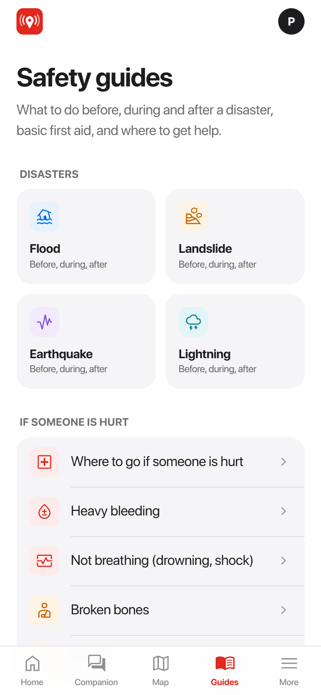
  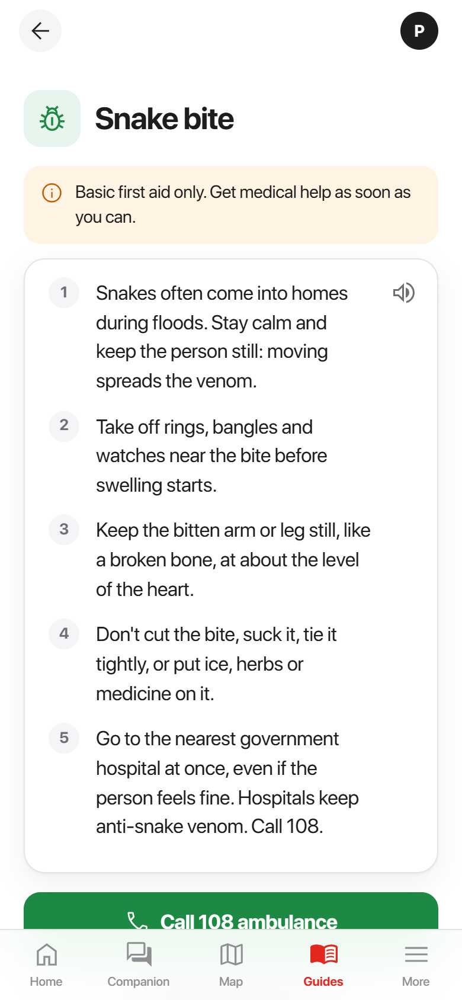

### 10. More tools for the moment

- **Relief camps and compass:** an arrow points to the nearest camp using GPS and the phone's compass, and keeps working offline.
- **Strobe and siren:** full-screen SOS flashing with a loud siren, and a separate rescue whistle.
- **Helplines:** tap to call 112, 108, 101, 1070, 1077, 1078, 1091, 1098 and 14416 (Tele-MANAS).
- **SMS fallback:** when data fails but there is signal, the SOS opens in the SMS app, ready to send to emergency contacts.

### 11. Control room dashboard

A live map of every SOS and rescue unit, and a queue **ranked by a fixed urgency score** with the breakdown shown (badly hurt +35, stuck +20, water height, vulnerable people, waiting time). **Gemini writes a one-line reason** and flags anything the score missed. The operator sees the answers, household, battery, location accuracy and the full chat, and marks each SOS received, dispatched or rescued; the person's phone updates. The operator can also create translated alerts, review hazard photos, read the nearby chat, and send a demo helicopter.

  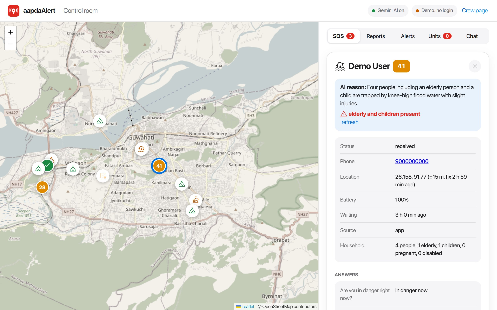

## Try every feature in two minutes

Open the app and tap **"Judge? Skip to the feature tour"** on the first screen (or go to **More > Feature tour**). It fills in sample details and shows one card per feature, each with a button that demonstrates it. That includes a switch that **simulates a network drop** and a **demo helicopter** that flies to your SOS. Keep the dashboard open on a second screen to watch everything arrive live.

## Built with

| Part | Technology |
|---|---|
| App | Installable web app (PWA), plain HTML, CSS and JavaScript, service worker and IndexedDB for offline use |
| AI | Google **Gemini 3.5 Flash Lite** for chat, question picking, safety steps, SOS reasons, photo checks and translation; **Gemini text-to-speech** for the voice |
| Server | Node.js serverless function on **Vercel** |
| Database | **Firebase Firestore** |
| Data | SACHET (NDMA) official alerts, Open-Meteo weather, OpenStreetMap |
| Design | **UX4G**, the Government of India design system: Material Symbols outlined icons, white theme, SF Pro and Inter, large touch targets |

## Privacy and safety

- No account or password. Household details stay on the phone until an SOS is sent.
- The name and phone number are never sent to the AI; it only sees counts such as "4 people, 1 elderly".
- Chats are saved on our server and processed by Google Gemini, and the app says so up front. "Delete my chats" removes them.
- In the nearby chat, locations are rounded to about 1 km and messages expire after 24 hours.
- Every AI answer comes with "If life is in danger, call 112 first", and first aid is marked as basic only.

## Honest limits of this demo

- **No login.** Anyone with the link can open the dashboard and crew page. A real launch needs operator and crew login.
- **Needs internet for the AI, map and live updates.** The SOS, danger questions and guides work offline, and the SOS waits until the network returns.
- **The nearby chat runs over the internet.** The same chat over Bluetooth needs a native app (see the roadmap).
- **Helicopter position comes from the crew page,** because military rescue helicopters often don't broadcast their position publicly.
- **SMS needs a tap.** A web app can prepare the message, but the person has to press send.
- **Demo data.** Relief camps, the starting alert and some hazard reports are samples, labelled "demo". "Issued by NDRF" labels are chosen by the operator in this demo.
- **Translations and first aid** should be checked by native speakers and a medical professional before real use.

## Roadmap

1. **Full offline mode:** offline safety steps, a saved map of your area, and passing an SOS on through a QR code.
2. **Native Android app with a Bluetooth mesh:** SOS messages and the nearby chat hop phone to phone until any phone finds a network.
3. **Helicopter sound detection** on the phone, so the alert works with no network at all.
4. **Real connections** to NDRF, SDRF, ASDMA and an SMS gateway, with verified senders.

---

  aapdaAlert is a hackathon demo. It is not a replacement for emergency services. <b>In an emergency, call 112.</b>
    
  Icons: Material Symbols (Apache 2.0) · Map: © OpenStreetMap contributors · Alerts: SACHET, NDMA · Weather: Open-Meteo

